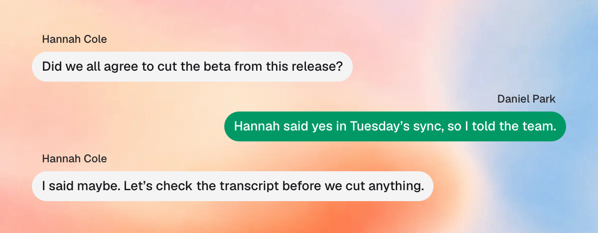

import { Showcase } from "/snippets/showcase.jsx";

Speaker labels put each person's name on what they said in your Zoom transcripts. Earmark reads the names from the Zoom app on your Mac while you capture, so no bot joins the call and nobody else has to set anything up.

<Info icon="apple">
**Built for Mac, with more platforms coming soon.** Speaker labels works in the Earmark desktop app for Mac. It's rolling out gradually, so if you don't see it in **Settings > Capture** yet, it's on its way to your account.
</Info>

## What's supported

<Columns cols={3}>
  <Card title="Zoom" icon="circle-check">
    <Badge color="green">Mac only</Badge>
  </Card>
  <Card title="Google Meet" icon="clock" color="#d97706">
    <Badge color="orange">Coming soon</Badge>
  </Card>
  <Card title="Microsoft Teams" icon="clock" color="#d97706">
    <Badge color="orange">Coming soon</Badge>
  </Card>
</Columns>

Use the Zoom desktop app, version 7.2.5 or later, in **Speaker**, **Gallery**, **Dynamic gallery**, or **Multi-speaker** view. To change views, click **View** in the top-right corner of the Zoom meeting window.

## Set up speaker labels

<Steps>
<Step title="Click Allow access">
In the Earmark desktop app, open **Settings > Capture**. Next to **Speaker labels**, click **Allow access**.

<Showcase
  src="/images/speaker-labels/settings-allow-access.png"
  alt="Earmark Settings, Capture page, with the Speaker labels row and its Allow access button."
  caption="Settings > Capture in Earmark"
/>
</Step>
<Step title="Turn on Earmark in System Settings">
System Settings opens to **Privacy & Security > Device Control and Data Access**. Turn on the switch next to **Earmark**. macOS may ask for your Mac password.

<Showcase
  src="/images/speaker-labels/system-settings.png"
  alt="macOS System Settings, Privacy & Security, Device Control and Data Access, with the switch next to Earmark turned on."
  caption="Device Control and Data Access in System Settings"
/>

On macOS 26 and earlier, this list is called **Accessibility**.
</Step>
<Step title="Come back to Earmark">
Switch back to Earmark. The row now shows **Allowed**.

<Showcase
  src="/images/speaker-labels/settings-allowed.png"
  alt="Earmark Settings, Capture page, with the Speaker labels row showing a green Allowed status."
  caption="Speaker labels is ready"
/>
</Step>
</Steps>

That's it. During a meeting there's nothing extra to do: capture as usual, and names appear in the transcript as people talk.

## What to expect

Each line in the live transcript shows who said it. Your lines use your Earmark profile name, and other people's use their Zoom names. While someone is still talking, a gray placeholder holds the spot until their name appears.

<Showcase
  src="/images/speaker-labels/transcript.png"
  alt="Expanded live transcript with speaker labels. Priya Shah's line is in a gray bubble on the left, Alex Rivera's line is in a green bubble on the right, and the line being spoken now is faded with a gray placeholder where the name will go."
  caption="Speaker labels in the live transcript"
/>

- **Lines Earmark isn't sure about stay unnamed.** Anyone Earmark can't safely name shows as **Them**.
- **Overlapping speech is harder.** When people talk over each other or right after one another, some lines may be labeled **Them** or get the wrong name.
- **Shared rooms show one name.** If several people join through one Zoom connection, like a conference room, they all get that connection's name.
- **Other audio isn't named.** Sound from other apps on your Mac can show up in the transcript without a name.
- **Immersive view isn't supported.** Switch to one of the views above.
- **Names start from your next capture.** Earlier transcripts keep their **Me** and **Them** labels.

## Privacy

Earmark uses this macOS permission only to read who's in your Zoom meeting and who's speaking, and only while you capture. It doesn't record your screen, read Zoom chat, or add a bot to the call. See [Security and privacy](/security-and-privacy) for how Earmark handles your meeting data.

To turn speaker labels off, turn off **Earmark** in **System Settings > Privacy & Security > Device Control and Data Access** (**Accessibility** on macOS 26 and earlier).

## Troubleshooting

<AccordionGroup>
<Accordion title="Speaker labels isn't in Settings">
Make sure you're using the latest Earmark desktop app for Mac. Speaker labels is rolling out gradually, so it may not be on for your account yet.
</Accordion>

<Accordion title="Allow access doesn't change to Allowed">
In **System Settings > Privacy & Security > Device Control and Data Access** (**Accessibility** on macOS 26 and earlier), turn **Earmark** off and on again, then switch back to Earmark. If it still doesn't show **Allowed**, quit and reopen Earmark.
</Accordion>

<Accordion title="Names show as Them">
1. **Check your Zoom app.** Use the Zoom desktop app, version 7.2.5 or later, not Zoom in a browser.
2. **Use a supported view.** Speaker, Gallery, Dynamic gallery, or Multi-speaker. In large meetings, use Speaker view.
3. **Keep the meeting window open.** Names pause while it's minimized.
4. **Turn on Always show meeting controls.** In Zoom, open **Settings > General** and turn it on. Gallery names can pause while Zoom hides its controls.
</Accordion>
</AccordionGroup>
